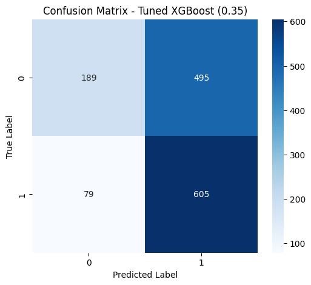

# ICU Mortality Prediction Using Machine Learning

**Effat University | Computer Science | 2026**  
Python · scikit-learn · XGBoost · Data analysis

A collaborative university project examining ICU mortality classification using structured patient data. We compared eight machine-learning classifiers, studied class imbalance and noisy labels, and evaluated the effect of adjusting prediction thresholds.

## Project overview

- **Dataset:** 15,000 ICU records with 24 variables, drawn from a [public Kaggle dataset](https://www.kaggle.com/datasets/jayjoshi37/icu-patient-monitoring-and-mortality-prediction).
- **Methods:** exploratory analysis, preprocessing, feature selection, class-imbalance handling, model comparison, threshold tuning, and robustness experiments.
- **Models:** Logistic Regression, Decision Tree, Random Forest, SVM, KNN, Naive Bayes, Gradient Boosting, and XGBoost.
- **Selected features:** ventilation requirement, vasopressor use, sepsis status, APACHE score, SOFA score, comorbidity score, and age.

### Results

One evaluation of tuned XGBoost (threshold **0.35**) reported **88.5% recall**, **67.8% F1**, and **0.641 ROC-AUC** on a balanced evaluation set. These results are specific to that experiment; the notebook contains additional experiments and settings. See [evaluation notes](REPRODUCIBILITY.md).

## Research

The team also prepared a **separate Data Science research manuscript** based on the same underlying ICU mortality topic:

**[ICU Mortality Prediction Using Machine Learning: A Practical Framework for Risk Stratification](https://aiccsa.net/AICCSA2026/papers.php)**  
Sarah Elshiaty, Mashael Saeed, Seifeldin Elshiaty, and Passent Elkafrawy.  
**Accepted at ACS/IEEE AICCSA 2026**, AICities track, paper #2302. The team delivered the conference presentation by video.

The conference manuscript and the Machine Learning course project are related but **not interchangeable versions of the same report**. The conference acceptance is verified; IEEE Xplore publication is not claimed.

## Files

| File | Contents |
| --- | --- |
| [notebook/](notebook/) | ML experiments and evaluation code |
| [images/](images/) | Class distribution, confusion matrix, feature importance, ROC curve |
| [requirements.txt](requirements.txt) | Main Python dependencies |
| [data/](data/) | Dataset information and download source |
| [prototype/](prototype/) | Interface demonstration link |
| [ASSET_SOURCES.md](ASSET_SOURCES.md) | Original project documents and larger media |

## Running the project

1. Clone this repository and install Python 3.
2. Run `python -m pip install -r requirements.txt`.
3. Download the [ICU dataset](https://www.kaggle.com/datasets/jayjoshi37/icu-patient-monitoring-and-mortality-prediction).
4. Open [ML_Final_Project_Code.ipynb](notebook/ML_Final_Project_Code.ipynb) in Jupyter or Google Colab and follow its data-loading cells.

The notebook contains multiple experiments and has not been independently validated as a single-command reproduction of the conference paper.

## Contributors

**Sarah Elshiaty · Mashael Saeed · Seifeldin Elshiaty**  
Conference manuscript co-author: **Passent Elkafrawy**

This project was developed as a team. The [original team repository](https://github.com/M1sh13l/ICU-Mortality-Prediction-ML) retains the development history; [Sarah's fork](https://github.com/SarahElshiaty/ICU-Mortality-Prediction-ML) is also retained. See [contributors and attribution](CONTRIBUTORS.md).

**Note:** Academic research only. Not a clinically validated medical prediction system.
