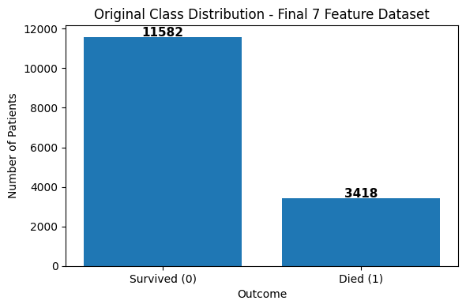
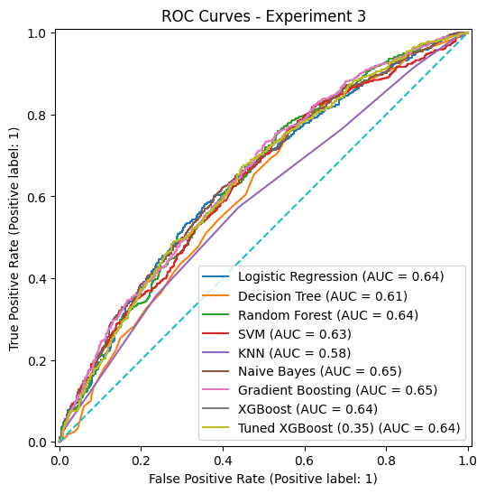
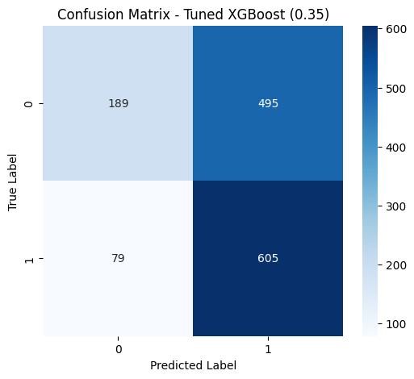
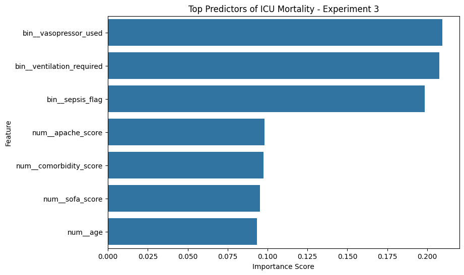

# Visualizations

These figures were copied from the original collaborative project. The research notebook contains additional exploratory and evaluation plots.

### Class distribution

### ROC curve

### Confusion matrix

### Feature importance

### Methodology workflow

The larger workflow image remains available in the [original team's repository](https://github.com/M1sh13l/ICU-Mortality-Prediction-ML/blob/main/images/Methodology_Workflow.png).

Interpret the evaluation figures in light of the [manuscript's study design and limitations](../REPRODUCIBILITY.md).
